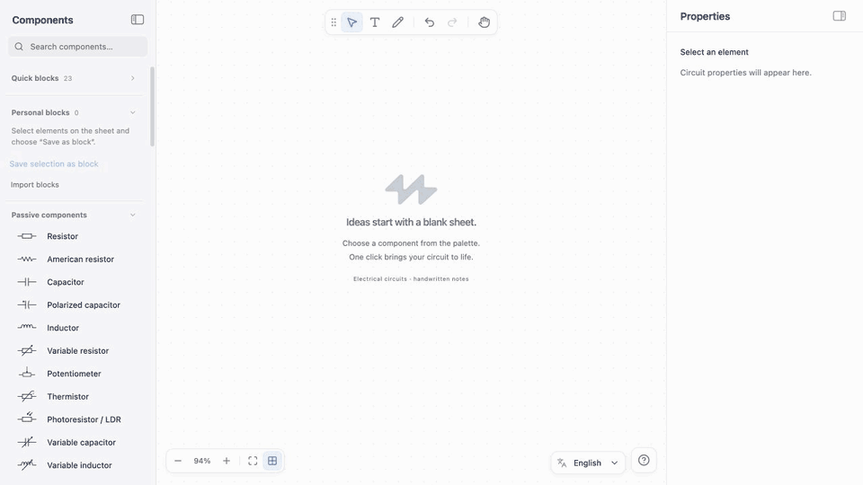

<p align="center">
  
</p>

<h1 align="center">DrawCircuit</h1>

<p align="center">Electrical diagrams, made simple.</p>
<p align="center">A focused, open-source editor for creating clean circuit diagrams in your browser.</p>

<p align="center">
  <a href="https://andrelombardo.github.io/DrawCircuit/"><strong>Open DrawCircuit →</strong></a>
</p>

<p align="center">
  <a href="README.it.md"></a>
</p>

<p align="center">
  
</p>

<p align="center">
  <a href="docs/guide.md">User guide</a> · <a href="CONTRIBUTING.md">Contributing</a>
</p>

## What is DrawCircuit?

DrawCircuit is a free, browser-based editor built for students, educators, and anyone who needs to communicate an electrical circuit clearly. Create a diagram, refine its layout, annotate it, and copy it into your notes or documents—without signing up or installing anything.


## Features

- **Draw precisely.** Choose from 72 electrical symbols across 12 categories. Connect components with orthogonal, 45°, or free-routing wires, with snapping and alignment assistance.
- **Explain visually.** Add mathematical labels, polarity markers, voltage and current annotations, arrows, and editable highlights. LaTeX-style expressions are rendered with KaTeX.
- **Keep everything aligned.** Move, rotate, mirror, distribute, and space elements with precise controls. Connections follow your edits.
- **Build faster.** Start from 23 ready-made circuit blocks, or save your own selections as reusable personal blocks.
- **Take your diagrams anywhere.** Copy the entire circuit—or just a selection—as a transparent PNG. Your work is saved automatically in your browser, with no account required.

## Get started

**[Launch DrawCircuit](https://andrelombardo.github.io/DrawCircuit/)** and start drawing:

1. Pick a component from the library and click to place it.
2. Press **W** to connect terminals with wires; use **N** to add junctions.
3. Double-click a label to edit it, or select an object to adjust its properties.
4. Right-click your selection and choose **Copy as image** to use it elsewhere.

For shortcuts, annotations, layout tools, and reusable blocks, see the **[user guide](docs/guide.md)**.

> [!note]
> **Your work stays in your browser.** Drawings, personal blocks, and preferences are stored locally. Clearing your browser data may remove them.

## Run locally

Use **Node.js 26.5.0** (see [`.nvmrc`](.nvmrc)) and npm:

```bash
git clone https://github.com/andrelombardo/DrawCircuit.git
cd DrawCircuit
npm ci
npm run dev
```

Open the local URL printed by Vite. To validate changes:

```bash
npm run lint
npm test
npm run build
```

## Contributing

Bug reports, ideas, and pull requests are welcome. Read [CONTRIBUTING.md](CONTRIBUTING.md) before making a change, or explore the [issues](https://github.com/andrelombardo/DrawCircuit/issues).

## License

Distributed under the [MIT License](LICENSE) © 2026 Andrea Lombardo. Third-party assets retain their own licenses, including Comic Relief under the [SIL Open Font License](src/fonts/comic-relief/OFL.txt).

