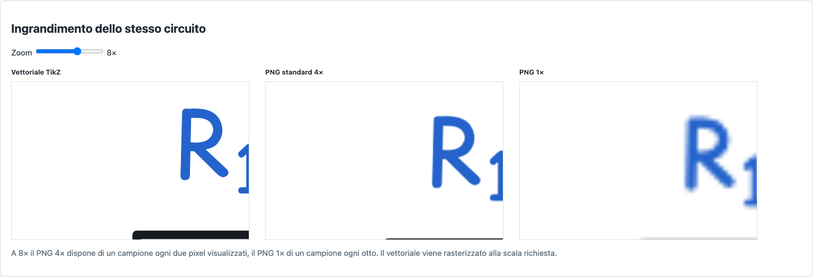

# DrawCircuit — TikZ Obsidian compatto e confronto PNG

Verifica locale del 15 ottobre 2026. Baseline: commit `b4598cc529ea03ff7c91635297a5e31b0fb1181d`. Misure e prove raccolte sulla build di produzione prima della pubblicazione.

**Per una resistenza singola conviene il PNG. Per i circuiti distinti con più componenti, formule o molte etichette conviene il TikZ ottimizzato nei campioni misurati, conservando anche il vantaggio vettoriale.** Il PNG occupa sempre meno spazio nel solo Markdown; nel vault bisogna contare il suo allegato. Riutilizzando lo stesso PNG in molte note, l’allegato unico può ribaltare il risultato. Le tabelle sotto misurano tutti questi casi, senza usare il gzip come dimensione del vault.

## Interventi implementati

Il traversal originale continua a determinare validazione, geometria, colori, fili, annotazioni, label e ordine di pittura. La modalità standard resta identica. La sola modalità Obsidian raccoglie anche i frammenti SVG e sceglie le risorse effettivamente usate, poi applica passaggi deterministici con una verifica del costo in caratteri.

- **Font:** rilevamento dei caratteri nell’SVG renderizzato, compresi i run KaTeX e il grassetto. Viene incluso solo il peso necessario. I subset conservano ID, avanzamenti, tabelle metriche, nomi `post`, hinting, GDEF e GSUB originali; includono componenti compositi, sostituzioni localizzate e composizioni canoniche Unicode. Le voci cmap annunciano soltanto contorni conservati. Le posizioni dei glifi rimangono quelle misurate prima dell’ottimizzazione.
- **Riferimenti tipografici:** ASCII completo e alfabeti greco/cirillico quando usati rimangono tra le dipendenze. La rasterizzazione consulta contorni non stampati per baseline, x-height e autohinting. Il subset limitato ai caratteri visibili e quello con soli riferimenti “blue zone” sono stati scartati: modificavano pixel o metriche, anche quando gli avanzamenti erano identici.
- **Scelta del contenitore:** WOFF2 precalcolati per il sottoinsieme comune; WOFF costruito in modo sincrono per gli altri insiemi. Il costo comprende le combinazioni dei pesi e la licenza condivisa; viene conservato il blocco completo più corto. Cache limitata a 64 insiemi, decodifica delle sorgenti una volta per peso, nessun compilatore font o WASM nell’app. La scelta del font non dipende dall’ordine delle esportazioni precedenti.
- **Licenza:** copyright e OFL completa nei metadati XML compressi di ogni font derivato, verificati dopo la compilazione. Se viene scelto un font originale, rimane la licenza completa nel CSS. Nessun CDN, font installato o servizio esterno è richiesto per i glifi coperti dai font originali. [Formato WOFF e metadati](https://www.w3.org/TR/WOFF/), [fontTools](https://fonttools.readthedocs.io/en/stable/subset/index.html).
- **TikZ:** stili condivisi soltanto se la definizione costa meno delle ripetizioni. Macro con al massimo nove parametri riutilizzano la struttura dei percorsi ripetuti; espandono le coordinate letterali originali, senza calcoli, nuove trasformazioni o modifiche alla precisione. Nessun accorpamento di operazioni di pittura, quindi opacità, compositing e sovrapposizioni restano distinti. Commenti descrittivi rimossi. Il preambolo dichiara gli stessi 62 simboli attraverso un ciclo TeX.
- **SVG:** serializzazione ASCII sicura, entità per metacaratteri TeX/XML e Unicode, proprietà tipografiche comuni ereditate quando conviene, rimozione del solo gruppo con traslazione zero. I rettangoli non dipinti dei bounding box sostituiscono i quattro vertici solo quando più brevi, mantenendo gli stessi estremi arrotondati. Le formule restano run SVG del layout KaTeX, con source TeX di fallback.
- **Trasporto:** continuazioni corte senza perdita degli spazi iniziali e senza spezzare `\string`. I frammenti storici con taglio ambiguo conservano la serializzazione originale, anche dove il vecchio trasporto produceva un nome famiglia senza spazio. Non è stata inclusa una correzione visiva estranea all’ottimizzazione.

`exportObsidian(doc, { compact: false })` conserva l’esportazione originale per diagnosi e regressioni. Dati font mancanti, metadati SVG non riconosciuti o errori del subsetting usano le definizioni originali. Le singole rappresentazioni compatte vengono scelte soltanto se sono più corte; i casi non applicabili mantengono la forma precedente.

## Prove di equivalenza e regressione

Il bundle locale **Inline TikZ 0.2.1**, con il suo motore TikZJax e driver SVG, ha compilato **15 coppie prima/dopo**: 72 componenti in otto rotazioni, 400 componenti ripetuti, circuiti da 1/5/20/100 componenti, formule, Unicode, primi lunghi, fili e incroci, frecce riflesse, tutti i tipi di annotazione, opacità, sovrapposizioni e un caso senza DOM. I benchmark principali hanno tre compilazioni ripetute per variante dopo warm-up; l’SVG prodotto è deterministico.

**Zero pixel differenti su 228.338.814 pixel confrontati.** Scale 1×/2×/4×; per catalogo e circuito da 400 componenti, 1×/2× per contenere le allocazioni. Uguali anche viewBox, bounding box, contenuto dei run, matrici di trasformazione, famiglia, peso, stile, dimensioni e colori del testo. [Dati completi](evidence/visual-comparison.json).

La suite font verifica **6.000 casi**, entrambi i pesi, tutti i 599 codepoint dei font e un campione di Unicode non coperto, a cinque dimensioni: pixel e metriche identici. L’ispezione indipendente con fontTools controlla i contorni, cmap, dipendenze, tabelle tipografiche e licenza; i font attraversano il compilatore senza variazioni dei byte. [Glifi](evidence/after/font-regression.json), [risorse](evidence/font-resources.json).

Sono stati confrontati anche **10, 50 e 100 SVG inline nello stesso documento**, mescolando testo greco, cirillico, formule e circuiti ASCII. Le catture dei campioni prima/dopo hanno gli stessi byte PNG: i sottoinsiemi non nascondono i caratteri di altri circuiti. [Verifica delle note multiple](evidence/multinote-visual.json).

**67 artefatti estranei all’ottimizzazione sono identici byte per byte:** JSON, TikZ standard, standalone `.tex`, SVG e PNG delle fixture pertinenti. I 74 file protetti dell’editor, canvas, modello, store, matematica, SVG, PNG, font e PWA restano invariati. I test precedenti che verificano stringhe esplicite e commenti continuano a controllare il percorso originale; la nuova suite verifica l’espansione ordinata della rappresentazione compatta. [Hash e misure](evidence/measurements.json), [audit dei sorgenti](evidence/source-audit.json).

Il browser ha verificato anche la build di produzione sotto `/DrawCircuit/`: anteprima, contenuto reale degli appunti, selezione parziale, fallback manuale quando la copia è negata, esportazione offline a pagina caricata, PNG e `.tex` scaricati, documento e DOM del canvas invariati. Nessun errore JavaScript o richiesta esterna. [Esito UI](evidence/ui-verification.json).

## Come leggere le misure

Valori in **byte logici UTF-8 (B)**, senza stime. Le note TikZ contengono esclusivamente il blocco; le note PNG esclusivamente `![[nome.png]]`. I PNG normali provengono dall’attuale `exportPNG`, invariato, a 4× con i limiti esistenti. Le varianti 1×/2× usano il parametro già presente in `rasterizeSVG`; quelle bianche sono soltanto un confronto sul file generato, senza modifiche all’esportatore o all’interfaccia. Il gzip è misurato separatamente a livello 9.

<!-- measured-tables:start -->

## Codice copiato: misure reali

| Circuito               | Caratteri prima | Caratteri dopo | Byte prima | Byte dopo | Riduzione byte | Pixel identici |
| ---------------------- | --------------- | -------------- | ---------- | --------- | -------------- | -------------- |
| 1 resistenza           | 91766           | 18223          | 91768      | 18223     | 80.14%         | Sì             |
| 5 componenti           | 95898           | 20627          | 95900      | 20627     | 78.49%         | Sì             |
| 20 componenti          | 113554          | 28347          | 113556     | 28347     | 75.04%         | Sì             |
| 100 componenti         | 212839          | 69461          | 212841     | 69461     | 67.36%         | Sì             |
| Formule matematiche    | 123273          | 61058          | 123275     | 61058     | 50.47%         | Sì             |
| Molti glifi Unicode    | 109618          | 94040          | 109845     | 94265     | 14.18%         | Sì             |
| Circuito e annotazioni | 108222          | 47028          | 108224     | 47028     | 56.55%         | Sì             |

## Note e allegati nel vault

| Circuito               | TikZ originale B | Nota TikZ B | Nota PNG B | Allegato PNG B | PNG totale B | Più leggero | Risparmio sul maggiore |
| ---------------------- | ---------------- | ----------- | ---------- | -------------- | ------------ | ----------- | ---------------------- |
| 1 resistenza           | 91768            | 18223       | 17         | 7068           | 7085         | PNG         | 61.12%                 |
| 5 componenti           | 95900            | 20627       | 13         | 45781          | 45794        | TikZ        | 54.96%                 |
| 20 componenti          | 113556           | 28347       | 15         | 186828         | 186843       | TikZ        | 84.83%                 |
| 100 componenti         | 212841           | 69461       | 16         | 1060035        | 1060051      | TikZ        | 93.45%                 |
| Formule matematiche    | 123275           | 61058       | 17         | 396226         | 396243       | TikZ        | 84.59%                 |
| Molti glifi Unicode    | 109845           | 94265       | 16         | 673487         | 673503       | TikZ        | 86.00%                 |
| Circuito e annotazioni | 108224           | 47028       | 16         | 346001         | 346017       | TikZ        | 86.41%                 |

## Gzip, separato dal testo copiato

| Circuito               | Gzip originale B | Gzip ottimizzato B |
| ---------------------- | ---------------- | ------------------ |
| 1 resistenza           | 66228            | 13483              |
| 5 componenti           | 66758            | 13947              |
| 20 componenti          | 68101            | 14895              |
| 100 componenti         | 73782            | 17839              |
| Formule matematiche    | 69883            | 39449              |
| Molti glifi Unicode    | 68305            | 64359              |
| Circuito e annotazioni | 68208            | 28476              |

## Composizione del codice in byte

Le categorie sono disgiunte e sommano esattamente al file. Geometria comprende i percorsi non dipinti necessari ai bounding box; le macro geometriche restano in questa categoria. Il testo SVG è separato dai nodi, dal source TeX di fallback e dai loro contenitori. Font comprende i data URL, CSS, licenza e continuazioni TeX.

| Circuito / versione          | Font  | Preambolo | Testo SVG | Nodi / fallback | Geometria | Stili / colori | Wrapper / commenti |
| ---------------------------- | ----- | --------- | --------- | --------------- | --------- | -------------- | ------------------ |
| 1 resistenza prima           | 86686 | 3784      | 439       | 192             | 319       | 74             | 274                |
| 1 resistenza dopo            | 16432 | 813       | 270       | 192             | 279       | 74             | 163                |
| 5 componenti prima           | 86686 | 3784      | 2195      | 982             | 1751      | 74             | 428                |
| 5 componenti dopo            | 16432 | 813       | 1350      | 277             | 1228      | 364            | 163                |
| 20 componenti prima          | 86686 | 3784      | 10536     | 3965            | 7516      | 74             | 995                |
| 20 componenti dopo           | 16432 | 813       | 5792      | 1145            | 3638      | 364            | 163                |
| 100 componenti prima         | 86686 | 3784      | 58312     | 19952           | 40014     | 74             | 4019               |
| 100 componenti dopo          | 16432 | 813       | 30117     | 5852            | 15720     | 364            | 163                |
| Formule matematiche prima    | 86686 | 3826      | 28541     | 2794            | 1152      | 37             | 239                |
| Formule matematiche dopo     | 45478 | 855       | 12672     | 1138            | 550       | 202            | 163                |
| Molti glifi Unicode prima    | 86686 | 3805      | 16273     | 2053            | 752       | 37             | 239                |
| Molti glifi Unicode dopo     | 80084 | 834       | 11657     | 949             | 376       | 202            | 163                |
| Circuito e annotazioni prima | 86686 | 3784      | 8405      | 2816            | 5772      | 259            | 502                |
| Circuito e annotazioni dopo  | 35588 | 813       | 4301      | 1386            | 3944      | 833            | 163                |

## PNG a risoluzioni diverse

| Circuito               | 1× pixel / B       | 2× pixel / B       | 4× normale pixel / B | 4× bianco B |
| ---------------------- | ------------------ | ------------------ | -------------------- | ----------- |
| 1 resistenza           | 98×66 / 1388       | 196×131 / 2836     | 392×260 / 7068       | 6881        |
| 5 componenti           | 698×77 / 7794      | 1396×153 / 18256   | 2792×304 / 45781     | 45454       |
| 20 componenti          | 1448×197 / 29669   | 2896×393 / 69462   | 5792×784 / 186828    | 186050      |
| 100 componenti         | 1448×1157 / 159162 | 2896×2313 / 388775 | 5792×4624 / 1060035  | 1054887     |
| Formule matematiche    | 816×611 / 65176    | 1631×1221 / 161060 | 3261×2442 / 396226   | 382830      |
| Molti glifi Unicode    | 1326×380 / 125101  | 2651×760 / 291195  | 5299×1519 / 673487   | 604241      |
| Circuito e annotazioni | 671×575 / 62936    | 1340×1147 / 137394 | 2680×2294 / 346001   | 319275      |

## Scenari con circuiti differenti

Da 1 a 20 componenti, cinque tipi ciclici, etichetta iniziale Circuito_i unica. Ogni PNG è stato generato realmente; le righe individuali sono nel JSON. Le note con più blocchi separano i circuiti con due newline.

| Scenario              | Nota/e TikZ B | Nota/e PNG B | Allegati B | PNG totale B |
| --------------------- | ------------- | ------------ | ---------- | ------------ |
| 1 nota × 1 circuiti   | 18459         | 18           | 14969      | 14987        |
| 1 nota × 10 circuiti  | 210068        | 199          | 544747     | 544946       |
| 1 nota × 50 circuiti  | 1155812       | 1039         | 5223018    | 5224057      |
| 100 note × 1 circuito | 2363855       | 1892         | 11688661   | 11690553     |

## Stesso allegato riusato

Il PNG viene conservato una volta; il blocco TikZ è duplicato in ogni nota.

| Circuito       | Note | TikZ totale B | PNG totale B | PNG vince da N note |
| -------------- | ---- | ------------- | ------------ | ------------------- |
| 1 resistenza   | 10   | 182230        | 7238         | 1                   |
| 1 resistenza   | 100  | 1822300       | 8768         | 1                   |
| 5 componenti   | 10   | 206270        | 45911        | 3                   |
| 5 componenti   | 100  | 2062700       | 47081        | 3                   |
| 100 componenti | 10   | 694610        | 1060195      | 16                  |
| 100 componenti | 100  | 6946100       | 1061635      | 16                  |

## Tempi di compilazione

Mediana di tre compilazioni per variante con lo stesso bundle, dopo warm-up. Sono tempi del motore isolato, esclusi UI e cache di Obsidian.

| Circuito               | TikZ prima ms | TikZ dopo ms |
| ---------------------- | ------------- | ------------ |
| 1 resistenza           | 418.3         | 391.5        |
| 5 componenti           | 472.7         | 442.2        |
| 20 componenti          | 725.4         | 676.5        |
| 100 componenti         | 2234.1        | 2050.5       |
| Formule matematiche    | 565.0         | 537.9        |
| Molti glifi Unicode    | 502.0         | 486.2        |
| Circuito e annotazioni | 709.8         | 660.6        |

## Decodifica PNG nel browser

Mediane di sette caricamenti da Blob locale: file già letto, nessuna misura del disco. La creazione dell’SVG TikZ nel motore e la decodifica PNG sono fasi diverse; questi tempi non sono una misura end-to-end dell’app Obsidian.

| Circuito               | Decode ms | Decode + draw ms |
| ---------------------- | --------- | ---------------- |
| 1 resistenza           | 0.50      | 0.50             |
| 5 componenti           | 1.30      | 1.70             |
| 20 componenti          | 5.80      | 7.50             |
| 100 componenti         | 0.90      | 12.00            |
| Formule matematiche    | 12.20     | 15.80            |
| Molti glifi Unicode    | 12.80     | 16.20            |
| Circuito e annotazioni | 8.90      | 11.20            |

## Allocazione osservata sul filesystem del test

stat.blocks × 512, misurata sui file prodotti. Dipende da filesystem, compressione, cloni e dimensione dei blocchi: non equivale a una previsione fisica portabile del vault. Le raccomandazioni usano le dimensioni logiche sopra.

| Circuito               | TikZ allocato B | PNG + riferimento allocati B |
| ---------------------- | --------------- | ---------------------------- |
| 1 resistenza           | 20480           | 12288                        |
| 5 componenti           | 24576           | 53248                        |
| 20 componenti          | 28672           | 192512                       |
| 100 componenti         | 69632           | 1118208                      |
| Formule matematiche    | 61440           | 401408                       |
| Molti glifi Unicode    | 98304           | 679936                       |
| Circuito e annotazioni | 49152           | 352256                       |

<!-- measured-tables:end -->

## Qualità grafica e scelta del formato



Il PNG standard a 4× è nitido alla dimensione normale del circuito. Non è equivalente al vettoriale: nell’ingrandimento a 8× della cattura si vede la sfocatura del PNG 4× e la perdita molto più marcata del PNG 1×; il testo vettoriale continua a essere rasterizzato alla risoluzione richiesta. Anche cornici e antialiasing possono differire tra PNG e TikZ: i due esportatori conservano le rispettive regole di crop e padding. L’equivalenza pixel-perfect riguarda il **TikZ originale contro quello ottimizzato**, non PNG contro SVG.

Le risoluzioni minori riducono molto il PNG, con un compromesso reale di risoluzione. Nel campione da cinque componenti il PNG 1× è più piccolo del TikZ; per venti componenti i due pesi diventano vicini. Per cento componenti, formule, Unicode e annotazioni il TikZ resta più piccolo anche del PNG 1× misurato. La riduzione di risoluzione diventa evidente ingrandendo testi piccoli, pedici, frazioni, curve e linee sottili.

I PNG opachi bianchi misurati sono più piccoli dei trasparenti, ma cambiano lo sfondo e il comportamento nei temi scuri: non sono stati adottati come ottimizzazione equivalente. I file normali conservano la trasparenza. [Confronto interattivo con tutti i file](comparison.html), [formule](evidence/formula-quality.png).

Per circuiti distinti, la convenienza non dipende soltanto dal numero di componenti: contano quantità e pesi dei font, risoluzione, area occupata e complessità del testo. Nella serie rappresentativa `Circuito_i`, il passaggio da PNG a TikZ avviene già tra uno e due componenti; non è una soglia universale. Il vantaggio del TikZ nei circuiti grandi qui è sostanziale, oltre il 93% rispetto al PNG normale nel caso da cento componenti. La densità del campione Unicode lascia meno contorni eliminabili: qui la riduzione del codice copiato è circa il 14%. Il confronto di costo comprende anche il font completo quando conviene.

Nel riuso dello stesso circuito, il PNG viene contato una sola volta, mentre il blocco TikZ viene duplicato come richiesto dal confronto. Per cinque componenti il PNG diventa più leggero dalla terza nota; per cento componenti dalla sedicesima. Questi conti cambiano se si evita anche la duplicazione del codice TikZ.

## Prestazioni, costi e limiti

I tempi sopra misurano il motore isolato e le chiamate browser per decodifica e draw del PNG. Non sono tempi end-to-end di Obsidian, né una misura del paint GPU. Le ripetizioni PNG possono beneficiare delle cache del browser. La compilazione TikZ aggiunge un lavoro che il PNG già rasterizzato non richiede; per una nota con molti circuiti il PNG favorisce l’apertura rapida. Non sono disponibili misure affidabili della memoria comparata, delle cache del vault, della riapertura o della ricompilazione dopo modifica nell’app Obsidian: nessun valore è stato inventato o ottenuto moltiplicando i tempi singoli per simulare l’intera app.

La nuova dipendenza runtime è limitata alle funzioni sincrone zlib di **fflate: 8.996 B minificati / 4.499 B gzip** nel bundle isolato misurato. Le risorse dei font sono preparate in anticipo e raccolte in un chunk separato, riutilizzabile dalla cache HTTP fra versioni dell’app. **Il sito ha un costo iniziale aggiuntivo di 123.610 B gzip per JavaScript e risorse font**, documentato in [bundle-size.json](evidence/bundle-size.json); la riduzione del codice copiato non viene presentata come una riduzione del download dell’app. Non ci sono decodificatori WOFF2, compilatori font, API o elaborazioni esterne durante l’esportazione. Il [notice della dipendenza](../../public/third-party/fflate.txt) accompagna la distribuzione.

È stato eseguito Inline TikZ 0.2.1 con il suo bundle esatto, identificato dall’hash nel report visuale. Il wrapper e i controlli dei driver TikZJax/`pgfsys-ximera`/`pgfsys-dvisvgm` restano quelli precedenti. Il plugin Obsidian TikZJax separato e altri browser/sistemi operativi non sono stati eseguiti: la prova pixel-perfect vale per Chromium 156.0.8078.4 nell’ambiente indicato. Le modalità senza DOM e i driver diversi conservano il fallback preesistente; non è stata introdotta una promessa di identità fra font diversi. I caratteri fuori dalla copertura originale di Comic Relief conservano il fallback precedente, senza aggiungere font nuovi o dipendenze di rete.

Sono stati scartati: subset con soli glifi stampati, rimozione dei nomi `post`, set di riferimento troppo piccoli, trasformazioni locali con diversa aritmetica di arrotondamento, fusione di path con compositing potenzialmente diverso, sostituzione dei simboli con CircuitikZ e delle formule SVG con LaTeX nativo. Non vengono usate astrazioni geometriche quando costano più dei percorsi che sostituirebbero.

## Controlli finali

`npm ci`, `npm run lint`, `npm run test` e `npm run build`: passati con Node 26.5.0. **1.869 test passati in 66 file.** Sono superati anche i confronti del renderer, le 6.000 prove dei font, le note multiple e il browser sulla build di produzione. I log e gli hash finali sono in [verification.json](evidence/verification.json).

## Riproduzione

Node **26.5.0**. Gli input originali e gli output prima dell’intervento sono in `evidence/before`; il benchmark rifiuta di sovrascrivere baseline diverse. La fixture complessa usa il JSON congelato e tutte le altre hanno ID deterministici. Gli output finali e le note PNG pronte sono in `evidence/after`.

```sh
npm ci
npx playwright install chromium
npm run lint
npm run test
npm run build
npm run benchmark:obsidian -- before
npm run benchmark:obsidian -- after
npm run test:obsidian:visual -- /percorso/inline-tikz/main.js
npm run test:obsidian:multinote
npm run test:obsidian:ui
node scripts/summarize-obsidian.mjs
```

Il bundle del compilatore non viene copiato nel repository. Per rigenerare i font e ispezionare le loro tabelle serve solo nell’ambiente di sviluppo `fonttools[woff]==4.60.2`, con Brotli 1.2.0; vedere [istruzioni dei font](../../src/tikz/font-data/README.md). Dopo la compilazione eseguire `python scripts/check-obsidian-resources.py` nello stesso ambiente. La fixture senza DOM si rigenera con `node scripts/check-obsidian-fallback.mjs /percorso/checkout-baseline`, usando il commit indicato sopra.

**Raccomandazione:** PNG standard per simboli o circuiti molto piccoli, riuso ripetuto e apertura rapida; TikZ ottimizzato per circuiti distinti più grandi, formule e necessità di ingrandimento. Guardando il solo Markdown vince sempre il riferimento PNG; guardando tutto il vault, nei benchmark da cinque componenti in su il TikZ conserva meno byte e maggiore libertà di zoom.
