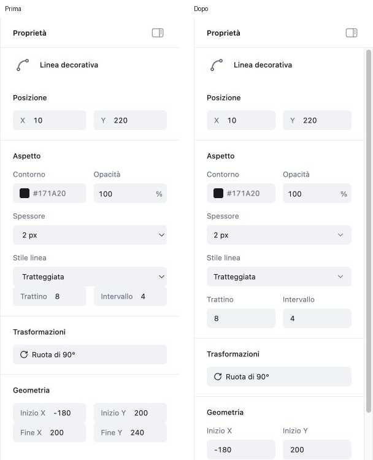
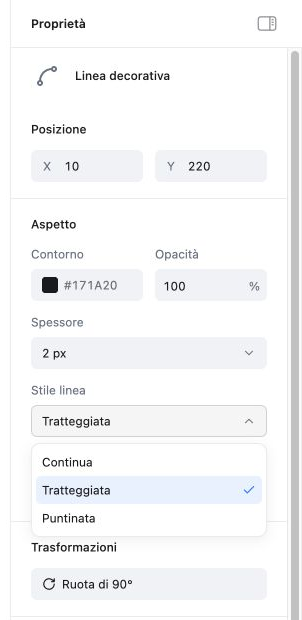
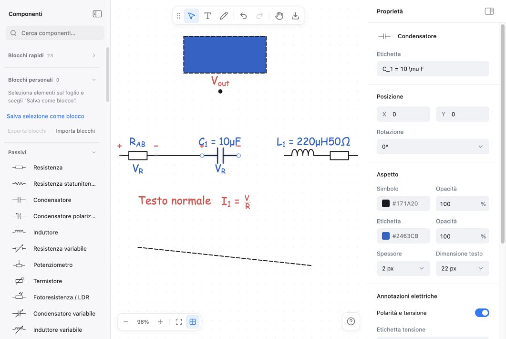
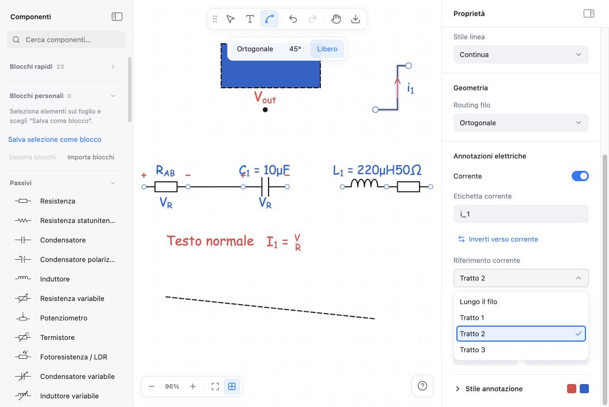
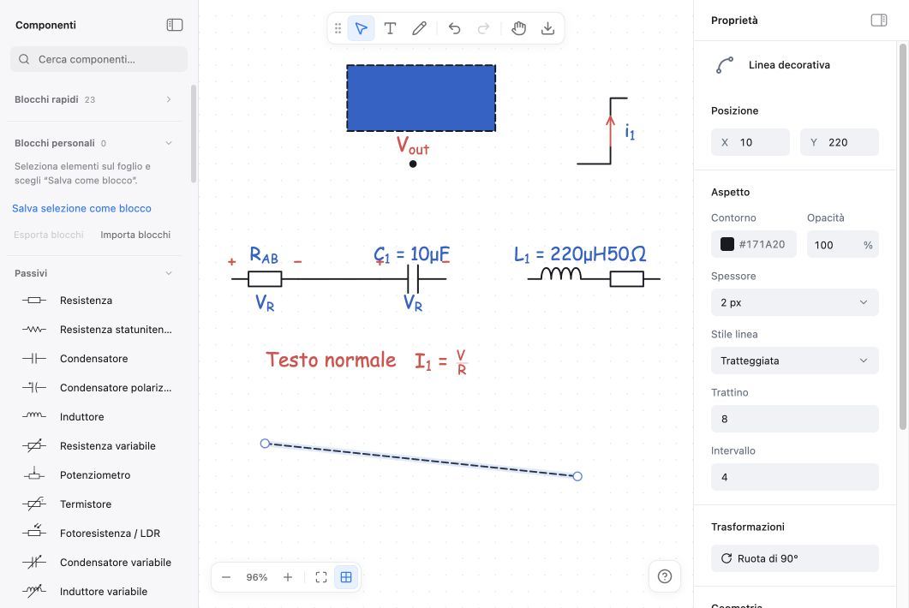
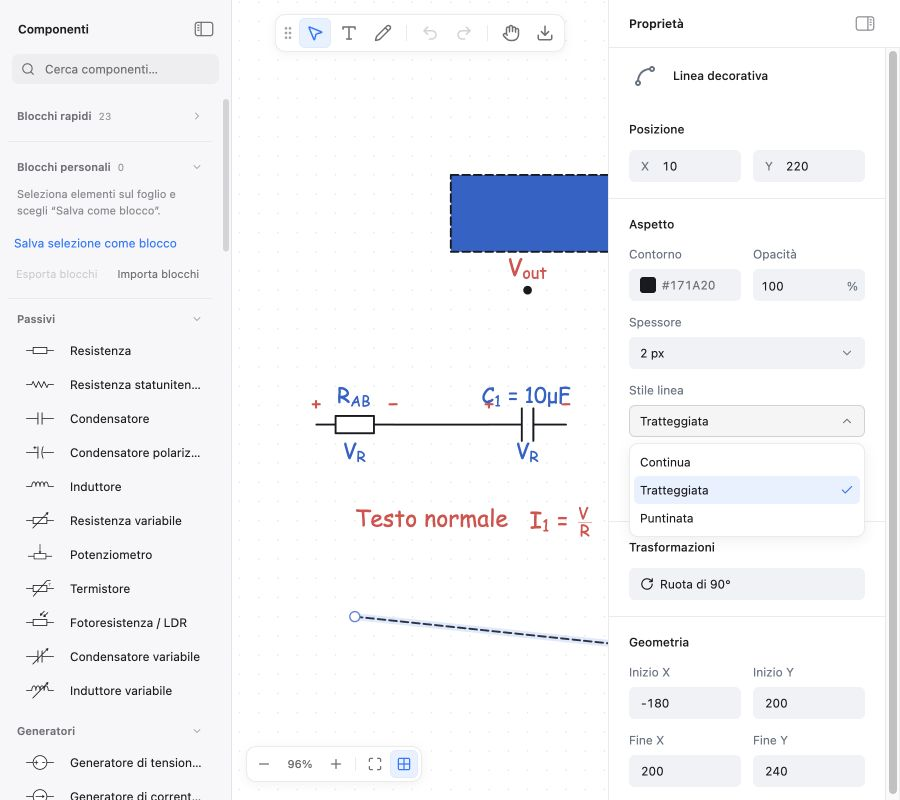

# Sidebar Proprietà — coerenza dei controlli

13 ottobre 2026. Audit e correzione della sidebar a partire dalle immagini inviate dall’utente, mantenendo le rifiniture di padding e tipografia del passaggio precedente.

## Risultato

I selettori della sidebar usano il menu condiviso dell’editor. Le righe condizionali hanno una distanza regolare, le etichette lunghe non occupano lo spazio dei valori e il cambio di oggetto riporta il pannello al suo inizio. La corrente può riferirsi all’intero filo oppure a un singolo tratto, mantenendo la percentuale quando cambia riferimento.

## Passaggi verificati

1. **Linea tratteggiata — corretto.** Riprodotto il contatto tra il selettore e i parametri: distanza iniziale **0 px**, finale **12 px**. `Trattino` e `Intervallo` hanno didascalie sopra ai valori; a 252 px si dispongono in verticale. Anche `Inizio X/Y` e `Fine X/Y` sono separati e leggibili. [Prima](evidence/02-dash-before.png), [dopo](evidence/04-dash-after.png).
2. **Menu e tastiera — coerenti.** Confrontato il [menu di disegno](evidence/01-shared-menu-before.png) con il [selettore della linea](evidence/05-shared-select-after.png). Tutti i `PropertySelect` condividono lo stesso componente: rotazione, spessore, testo, riempimento, stile linea, routing, tipo freccia, distribuzione, spaziatura e riferimento corrente. La scelta corrente ha una spunta; i valori misti non selezionano un’opzione arbitraria. Frecce, Home/End, ricerca per iniziale, Enter, Escape, Tab e clic esterno funzionano. Nella prova reale Tab passa dal menu della dimensione alla checkbox successiva; 40 px e undo ritornano a 22 px. Un menu il cui campo esce dalla vista si chiude, senza restare sul canvas.
3. **Stati condizionali e selezione — corretti.** Controllati [rettangolo con riempimento e tratteggio](evidence/06-rectangle-after.png), [testo](evidence/14-text-after.png), annotazioni con stile aperto e [selezione multipla di 15 oggetti](evidence/13-multiple-after.png). `Tipo riempimento` distingue il selettore dal campo del colore. Il cambio di oggetto ripristina lo scorrimento: nella prova da **280 px a 0 px**, rendendo visibili nome e posizione del condensatore. [Difetto](evidence/07-selection-scroll-before.png), [correzione](evidence/08-selection-scroll-after.png). Le modifiche sullo stesso oggetto mantengono invece la posizione del pannello.
4. **Corrente sul filo — corretta.** Il vecchio [menu dei tratti](evidence/09-wire-reference-before.png) non permetteva di tornare all’intero filo. [Riferimento corrente](evidence/10-wire-reference-after.png) offre sempre `Lungo il filo` e i singoli tratti. Prova reale al 60%; test dedicato al 75%, con percentuale conservata, filo ancora selezionato e undo dei cambi di riferimento.
5. **Larghezze e bordi — verificati.** [Sidebar minima 252 px](evidence/11-minimum-width-after.png), standard 292 px, massima 440 px e [finestra 900×800](evidence/12-narrow-window-after.png). Nessun overflow orizzontale nelle superfici controllate. A 440 px campo e menu misurano entrambi 384 px; a 900 px il popup resta dentro il viewport. Le dimensioni temporanee del browser sono state ripristinate.

## Catture degli stati verificati

## Problemi risolti

- **P2:** il menu nativo aveva forma, evidenziazione e comportamento diversi dal resto dell’editor. Sostituito mediante il componente già esistente, con opzioni `menuitemradio`, valore descritto e focus ripristinato.
- **P2:** gruppi consecutivi privi di separazione. La sezione gestisce ora la distanza tra i figli, comprese righe che compaiono solo in certi stati.
- **P2:** etichette lunghe all’interno di campi stretti. Etichette dei parametri e degli estremi sopra ai valori, con reflow alla larghezza minima.
- **P2:** pannello scorribile rimasto sul contesto precedente quando cambia la selezione. Ripristino al cambio di oggetto/etichetta, senza spostamenti durante l’editing dello stesso oggetto.
- **P2:** scelta del riferimento della corrente senza percorso di ritorno. Entrambi i riferimenti sono disponibili e annullabili.

## Evidenza e limiti

Riferimenti forniti dall’utente: [tratteggio](evidence/user-attached-dash.png) e [menu nativo](evidence/user-attached-dropdown.png). Tutte le altre catture sono state acquisite durante questo passaggio nel browser integrato, usando l’anteprima locale e un documento di prova su una porta separata.

Il confronto usa crop identici `(988, 0, 1280, 720)` delle catture 1280×720; nessuna scalatura o deformazione. La cattura separata del popup nativo non è stata accettata come prova perché la superficie del sistema operativo non compariva nell’immagine del browser: per quel dettaglio è stato usato il riferimento allegato dall’utente.

Suite completa: **61 file, 1.824 test superati**. Ultimi controlli mirati: **77 test superati**, compreso il mantenimento della percentuale tra i riferimenti. Lint, build, formattazione e controllo del diff superati. Console del browser senza errori o warning. Nessun P0/P1/P2 residuo nei passaggi elencati.

Le prove coprono i controlli e gli stati descritti; non costituiscono un’attestazione completa WCAG né una matrice separata Safari/Firefox. I dialoghi colore del sistema e il rendering del circuito non sono stati ridisegnati. La build mantiene il precedente avviso non bloccante sul chunk principale oltre 500 kB.
