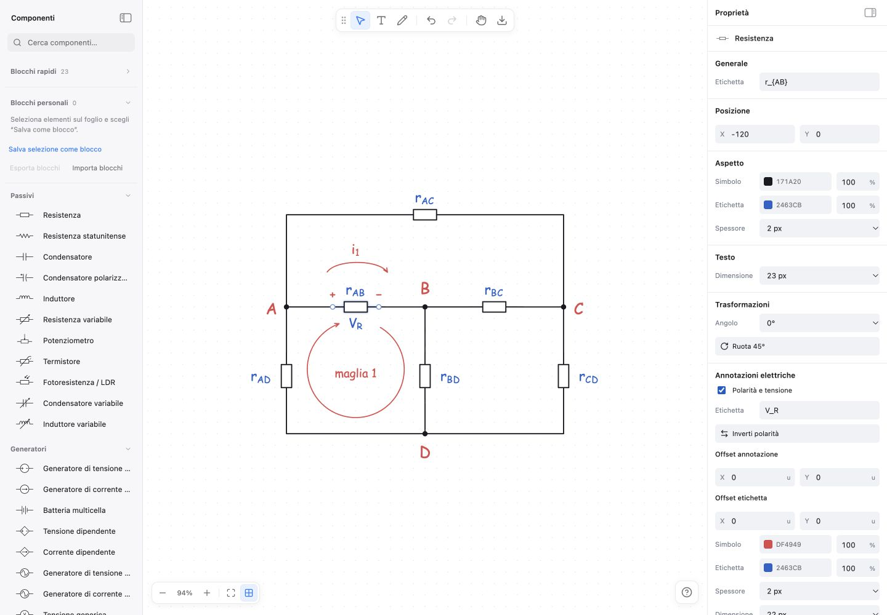
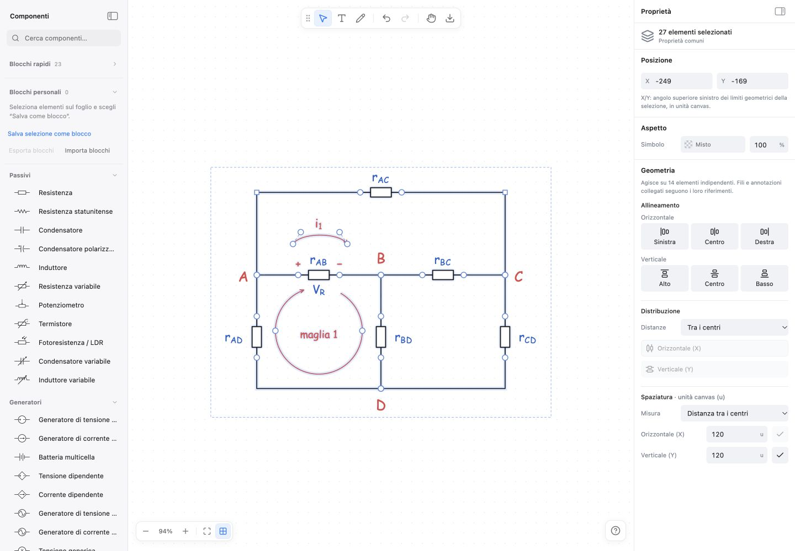
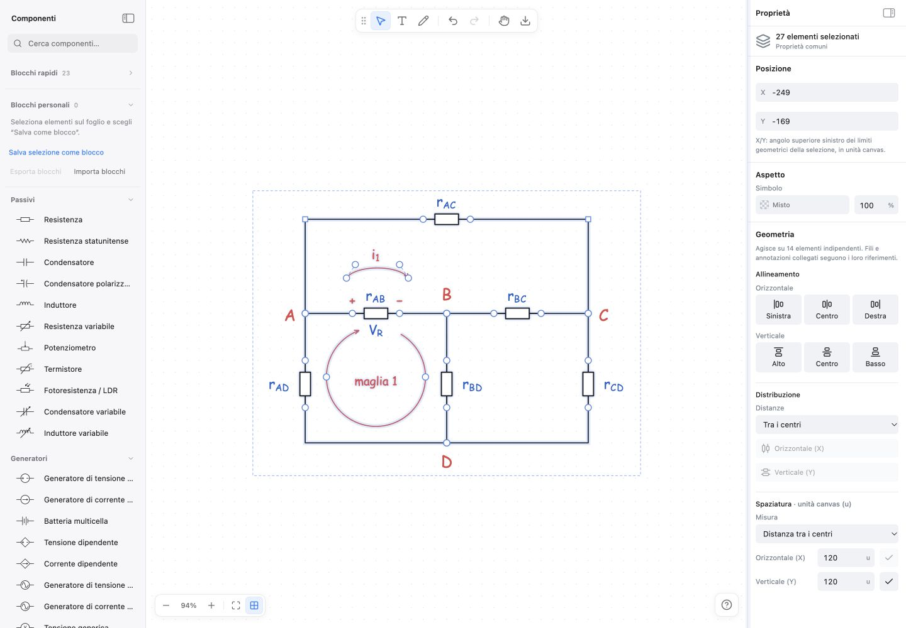

# Coerenza della sidebar destra

13 ottobre 2026. Revisione limitata a Proprietà, sulla build locale precedente alle modifiche. Direzione scelta dall’utente: seconda proposta Product Design, con correzione delle incongruenze.

1. **Componente con polarità — migliorabile.** Il contesto del componente resta visibile, ma il campo Angolo e il pulsante Ruota 45° si presentano come due controlli concorrenti. Nel codice il campo imposta l’orientamento, mentre il pulsante ruota la selezione con l’operazione di gruppo. “Etichetta” ricorre per componente e tensione. Sei sezioni principali frammentano proprietà semplici e spingono gli ultimi campi sotto il bordo della finestra. Correzione: un solo orientamento per l’oggetto, nome Tensione/Corrente per l’annotazione, griglia coerente e stile dell’annotazione richiudibile.

   

2. **Selezione multipla — funzionale, migliorabile nella lettura.** Sono presenti conteggio, stato Misto, entrambi gli assi e protezione dalle sovrapposizioni. Le spiegazioni occupano righe mentre alcuni pulsanti disabilitati sono molto pallidi. La rotazione dei singoli elementi e quella di un gruppo richiedono significati diversi: il comando collettivo deve indicare esplicitamente il gruppo e l’incremento, senza un campo che sembri l’angolo assoluto del gruppo.

   

3. **Larghezza minima — senza overflow, ma dispersiva.** A 252 px X e Y si impilano pur avendo spazio per una coppia compatta. Le didascalie cambiano disposizione rispetto alla larghezza standard. Correzione: didascalie sopra i campi in modo costante, coordinate affiancate dove leggibili, colori sempre in righe separate e percentuali con spazio riservato.

   

Il mock scelto è stato corretto prima dell’implementazione: due righe complete colore/opacità affiancate avrebbero ridotto eccessivamente lo spazio per HEX e percentuali. “Posizione dell’annotazione” è sostituito da Offset annotazione per indicare correttamente un valore relativo. Lo stile richiudibile usa un chevron coerente con il suo stato.

Accessibilità: le schermate evidenziano rischi nella dimensione della tipografia, nei comandi disabilitati e nella distinzione tra azioni e campi. Nomi accessibili, focus, tastiera, reflow e undo richiedono la verifica dell’implementazione; queste immagini da sole non attestano conformità WCAG.
