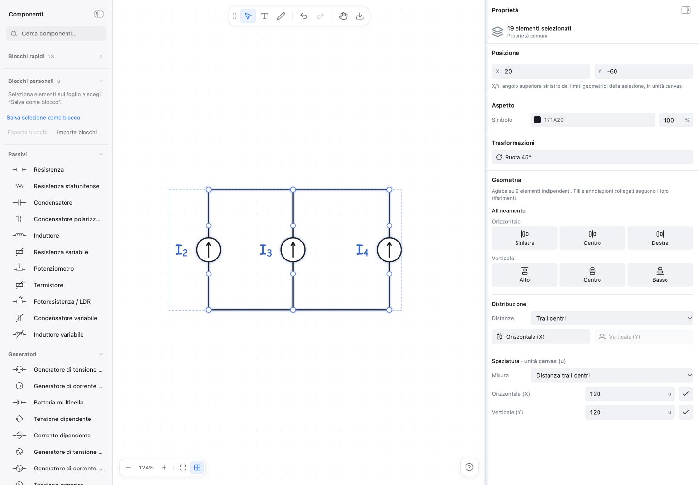
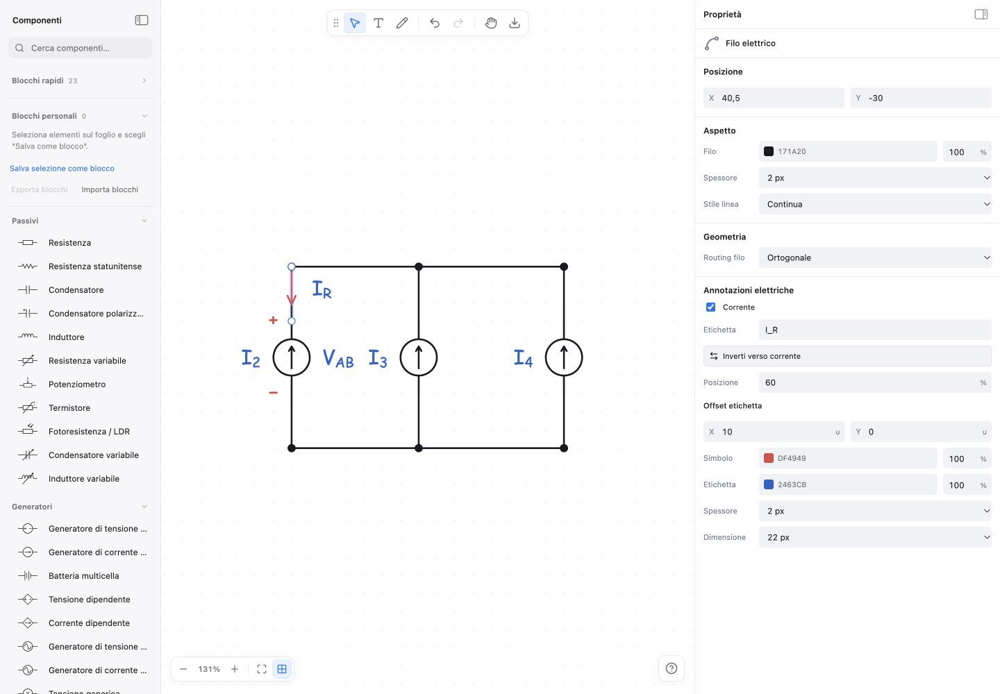

# Refactoring UX dell’editor

Verifica locale del 12 ottobre 2026, completata prima della pubblicazione richiesta il 13 ottobre 2026.

## Problemi risolti e scelte

- **Export della selezione:** il menu contestuale espone «Salva come immagine» per uno o più oggetti. Riutilizza `getExportSelection` e l’export SVG, includendo collegamenti interni e annotazioni associate. Il documento da esportare viene catturato prima delle operazioni asincrone, senza cambiare selezione o cronologia.
- **PNG trasparente:** nessun fondo bianco, griglia o controllo dell’editor. Gli incroci dei fili usano interruzioni geometriche, evitando aloni bianchi. Font matematici, colori e opacità passano dalla stessa pipeline SVG. La rasterizzazione resta a 4× per i disegni ordinari, con i limiti dimensionali esistenti per quelli grandi.
- **Margini uniformi:** dopo la rasterizzazione si misurano i pixel non trasparenti e si applicano 8 unità di margine su tutti i lati, normalmente 32 pixel a 4×. La scansione procede per strisce di 128 righe; il margine si riduce uniformemente se necessario per rispettare le dimensioni già ammesse. Nessun ridimensionamento dei pixel del disegno durante il ritaglio.
- **Toolbar:** rimosso il pulsante Modifica e il relativo menu. Annulla, Ripeti, scorciatoie e operazioni contestuali restano disponibili. Sulle selezioni miste, «Sostituisci componenti…» chiarisce quali elementi vengono sostituiti.
- **Proprietà elettriche:** `ElectricalProperties` raccoglie polarità, tensione e corrente nella stessa vista del componente o filo selezionato. Attivazione, etichette LaTeX, inversioni, posizione, offset e stile modificano le annotazioni pertinenti senza selezionarle al posto del loro oggetto. I documenti con più annotazioni associate conservano controlli distinti per ciascuna.
- **Input e percentuali:** valore numerico e suffisso hanno colonne separate; il campo numerico riserva spazio sufficiente anche a 100. La griglia cambia disposizione in base alla larghezza effettiva del pannello. Alle larghezze minime le etichette si spostano sopra i campi e le coppie X/Y possono impilarsi.
- **Geometria multipla:** gruppi separati Allineamento, Distribuzione e Spaziatura; comandi X/Y contemporaneamente visibili. Le modalità distinguono centri e spazio libero tra bordi, con unità canvas `u` e tooltip sull’elemento fisso. Trasformazioni ha una sezione propria e appare solo per selezioni compatibili.
- **Protezione della geometria:** la distribuzione automatica richiede almeno tre oggetti, quella esatta almeno due. Sono rifiutati valori invalidi e disposizioni che sovrappongono i limiti geometrici degli oggetti. Fili vincolati e annotazioni associate seguono i riferimenti attraverso le operazioni esistenti; non vengono spostati una seconda volta come elementi indipendenti. Il pannello indica l’ambito dell’azione quando questo differisce dalla selezione.
- **Proprietà comuni:** stato Misto, controlli limitati alle capacità condivise e aggiornamenti collettivi annullabili in un solo passaggio. X/Y della selezione multipla indicano l’angolo superiore sinistro dei suoi limiti geometrici.
- **Ridimensionamento da tastiera:** corretta anche un’interferenza preesistente: le frecce sul separatore della sidebar venivano intercettate dallo spostamento del canvas. Ora ridimensionano il pannello senza muovere la selezione o aggiungere undo.

Il modello dei documenti resta alla versione 1. SVG conserva il comportamento predefinito; TikZ, CircuitikZ, Obsidian, salvataggio e struttura PWA non richiedono migrazioni.

## File principali

| Area                                  | File                                                                                                                                                |
| ------------------------------------- | --------------------------------------------------------------------------------------------------------------------------------------------------- |
| Toolbar e menu                        | `src/components/toolbar/Toolbar.tsx`, `useEditActions.tsx`, `HelpDialog.tsx`                                                                        |
| Comandi condivisi ed export selezione | `src/components/properties/SelectionActions.tsx`, `EditorCommandContext.ts`                                                                         |
| Proprietà e annotazioni               | `src/components/properties/PropertiesContent.tsx`, `ElectricalProperties.tsx`, `SelectionStyle.tsx`, `PropertyControls.tsx`, `annotationActions.ts` |
| Geometria                             | `src/components/properties/SelectionGeometry.tsx`, `src/utils/selectionGeometry.ts`                                                                 |
| Transazioni e tastiera                | `src/store/editorStore.ts`, `src/components/editor/useKeyboardNudge.ts`                                                                             |
| PNG/SVG                               | `src/png/exporter.ts`, `src/svg/exporter.tsx`, `src/utils/wireRendering.ts`                                                                         |
| Layout                                | `src/styles.css`                                                                                                                                    |
| Documentazione                        | `README.md`, `docs/manuale.md`, `docs/nuove-feature.md`, questo report e le prove allegate                                                          |

## Verifiche automatiche

Ambiente: Node **26.5.0**, dipendenze installate con `npm ci`.

| Comando                          | Esito                                                      |
| -------------------------------- | ---------------------------------------------------------- |
| `npm run lint`                   | Superato                                                   |
| `npm run test -- --maxWorkers=1` | 60 file, 1.812 test superati; suite completa, senza filtri |
| `npm run build`                  | Superato, incluso service worker PWA                       |
| `npm run format:check`           | Superato                                                   |
| `git diff --check`               | Superato                                                   |

I test nuovi in `tests/editor-ux-refactor.test.tsx` coprono export singolo e multiplo, errore PNG, toolbar e scorciatoie, pannelli elettrici senza cambio di selezione, compatibilità delle annotazioni, undo atomico, proprietà miste, selezione di 19 oggetti, assi separati, sovrapposizioni, trasformazioni incompatibili e conservazione dei collegamenti. Un test integrato verifica anche il ridimensionamento da tastiera senza modifica del circuito.

Aggiornati i test dei menu e del pannello alle nuove posizioni dei comandi. `tests/png-export.test.ts` verifica rasterizzazione, trasparenza, font, margini, cleanup e limiti di allocazione; `tests/precision-nudge.test.tsx` verifica che il separatore non attivi il movimento del canvas. La suite completa comprende le regressioni già presenti per gli altri export, serializzazione, salvataggio e operazioni dell’editor.

## Verifica nel browser

Usata la build di produzione servita localmente con Vite Preview su `http://127.0.0.1:5177/`. La verifica conclusiva della correzione da tastiera è stata eseguita su `http://127.0.0.1:5178/` per evitare la cache della build precedente della PWA: lo script caricato `index-D8Hc4efh.js` corrisponde a `dist/index.html`. Queste prove precedono la pubblicazione; il commit effettivamente online è verificabile nel workflow GitHub Actions di deployment.

| Scenario                          | Risultato osservato                                                                                |
| --------------------------------- | -------------------------------------------------------------------------------------------------- |
| Selezione multipla di 19 elementi | Gruppi distinti, entrambi gli assi visibili, coordinate spiegate, ambito di distribuzione indicato |
| Download dal menu contestuale     | PNG scaricato realmente, senza griglia o contorni di selezione                                     |
| Polarità sul bipolo               | Attivazione, label `V_{AB}`, inversione e offset mantenendo il componente selezionato              |
| Corrente sul filo                 | Label `I_R`, inversione, posizione al 60% e offset X a 10 mantenendo il filo selezionato           |
| Opacità                           | Valori 0, 10, 99 e 100 leggibili; cifre e `%` separati                                             |
| Sidebar desktop                   | Larghezze 252, 292 e 440 px; nessun overflow orizzontale nel pannello                              |
| Finestra                          | 1440×1000, 900×800 e 600×760; conservato il comportamento a sovrapposizione sui formati stretti    |
| Console                           | Nessun errore o avviso rilevato durante le verifiche                                               |

Il [PNG scaricato](evidence/selection-transparent.png) misura **1568×900 pixel**, contiene **1.299.042 pixel completamente trasparenti** e ha **32 pixel di margine su ciascuno dei quattro lati**. I dati sono conservati in [png-verification.json](evidence/png-verification.json).

Ulteriori prove: [polarità](evidence/polarity-properties.png), [selezione nella sidebar minima](evidence/selection-min-sidebar.png), [corrente nella sidebar minima](evidence/current-min-sidebar.png), [sidebar standard](evidence/current-default-sidebar.png), [finestra da 900 px](evidence/current-900.png), [finestra da 600 px](evidence/current-600.png).

## Limiti della verifica

La verifica manuale è stata eseguita nel browser integrato, senza una matrice separata Safari/Firefox. Non è stata ripetuta un’installazione PWA con prova offline su dispositivo fisico. La build segnala ancora un chunk oltre la soglia indicativa di 500 kB; non impedisce la compilazione. Nell’esecuzione dei test con due worker e build concorrente, il test di stress DOM su 400 oggetti ha superato il timeout di 5 secondi (5,35 secondi); la suite completa è stata quindi rieseguita con un solo worker. I comandi che provocherebbero sovrapposizioni sono intenzionalmente disabilitati e ne spiegano il motivo nel tooltip.
